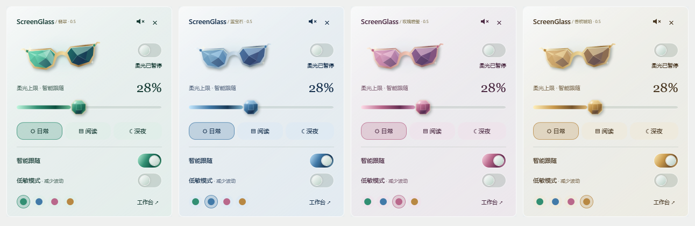

# ScreenGlass 0.8.0

给屏幕戴上一副珠宝太阳镜。原生 Windows 柔光工具，透明磨砂、切面宝石与金属细节。



## 直接运行

从 [GitHub Releases](https://github.com/legalstark/ScreenGlass/releases) 下载已发布的 Windows x64 ZIP，解压后双击 `ScreenGlass.exe`。本地打包后也可运行 `App/ScreenGlass.exe`。无需安装 .NET，无需管理员权限。

适配目标为 Windows 10 22H2（19045）、Windows 10 企业版 21H2 / LTSC 2021（19044），以及 Windows 11 22H2（22621）及更新版本，均为 x64。Win10 的视觉效果与流畅度待目标机器实测验收。磨砂材质遵循系统透明效果设置。启动默认暂停柔光。升级前先从托盘菜单退出旧程序，可在快捷框标题查看当前版本。

## 使用

- 单击托盘打开快捷框；双击打开完整工作台；点击外部或 Esc 收起；托盘右键可退出。
- 在托盘右键菜单选择「检查更新…」。发现更新时，可打开 GitHub 发布页下载新版。
- 点击太阳镜开关柔光，镜片与滑块上滚轮每次调整 1%，Shift + 滚轮每次调整 5%。
- 强度 5%–60%；智能跟随时为遮罩上限，手动模式为固定强度。调整强度或场景不自动开启柔光。
- 日常 28%、阅读 38%、深夜 50%；微暖色调改为每屏独立选项。自定义强度不再错误高亮场景。
- 智能跟随保留原来的连续亮度曲线，明显明暗变化在下一次采样时响应，并平滑过渡；小幅波动保持上次柔光强度，减少白底滚动微调。采样间隔约 0.96 秒，无额外确认等待。低敏模式独立使用原有触发阈值与连续两次确认，触发亮度可调为 30%–90%。
- 四套皮肤：翡翠、蓝宝石、玫瑰碧玺、香槟琥珀。快捷框底部色点或偏好页可切换，玻璃、文字、金属框和镜片一起变化，选择保存，不影响柔光算法。
- 音效提高可听度，并在后台同步播放。设置页可试听，快捷框喇叭右键也可试听；试听不改变静音设置。没有音频设备或播放失败时明确提示，不调整系统音量。
- Ctrl + Alt + S 开关柔光，Ctrl + Alt + A 切换智能跟随。偏好页可点击输入框录入自定义组合键，立即生效并保存；支持恢复默认，重复或被占用时明确提示。
- 快捷框随内容决定高度，窗口按显示器工作区与 DPI 放置；空间不足可滚动。镜片动效遵循系统动画设置。

偏好保存于 `%LOCALAPPDATA%\ScreenGlass\settings.json`。短时合并写入并原子替换；启动始终暂停柔光。

## 每屏固定调暗（0.7）

完整工作台和托盘快捷框都有“每屏调暗 / Dimming”。选择屏幕后可独立设置：

- 固定调暗 0%–90%：暗色页面也保持调暗，0% 表示不额外调暗。
- 此屏生效：只暂停所选显示器，总开关仍控制全部屏幕；启动始终暂停。
- 叠加柔光：关闭时只使用固定调暗，开启时叠加上方的智能或手动柔光。
- 微暖色调：独立开启，默认使用中性黑色遮罩；界面皮肤不影响遮罩颜色。

设置按 Windows 显示器设备接口身份保存，重新扫描或显示器次序改变不会按列表位置错配。改变接线端口可能产生新的设备身份。扩展桌面可独立控制；镜像输出共享同一桌面区域，不能分别覆盖。热插拔后自动重建遮罩。

固定调暗与柔光按透明度叠加，总遮罩上限 90%。纯黑像素无法再通过软件遮罩变暗；LCD 硬件背光不变。本次没有加入 DDC/CI 硬件亮度控制。

全屏遮罩改为原生分层窗口；暂停时不运行刷新定时器，固定模式在过渡完成后停止刷新。采样复用小位图，不再每轮创建位图和绘图对象。相同场景短时测量中私有内存由约 92 MiB 降到 78 MiB，总工作集仍约 147 MiB；详见 docs/DIMMING-VALIDATION.md。

## 体积与隐私

正式 ZIP 约 67 MiB，独立 EXE 约 72 MiB，包含桌面运行库。曾占用约 1.8 GB 的是开发目录内的 SDK、下载文件、运行库包缓存和重复发布文件，已迁出缓存并清理。

点击「检查更新…」时，应用向 GitHub 查询最新正式版本，请求包含应用名称和版本号。屏幕采样只在本机内存中处理，不保存截图或上传屏幕内容。这是整屏软件遮罩，不改变显示器硬件背光、不降低硬件功耗；系统安全桌面、受保护视频与独占全屏可能不被覆盖。不提供医疗效果承诺。

## 开发与本地打包

WPF / C# / .NET 10 LTS，无第三方 NuGet 功能依赖。安装 global.json 指定的 SDK 后：

```powershell
# 编译开发版
 dotnet build Source/ScreenGlass.csproj -c Release
# 生成本地单文件、分发 ZIP、校验文件和干净源码包，不上传
./scripts/Publish.ps1
```

本机便携工具与运行库缓存位于用户级 ScreenGlass.Build 缓存，不在项目中：

```powershell
# 使用本机缓存的构建工具
$env:NUGET_PACKAGES = "$env:LOCALAPPDATA/ScreenGlass.Build/nuget"
./scripts/Publish.ps1 -Dotnet "$env:LOCALAPPDATA/ScreenGlass.Build/dotnet/dotnet.exe"
```

保留产物为 `App/ScreenGlass.exe`、`dist/ScreenGlass-0.8.0-win-x64.zip`、其 `.sha256` 和 `dist/ScreenGlass-0.8.0-source.zip`。发布暂存目录自动清理，不重复保留解压副本。

发版时同步更新 `Source/ScreenGlass.csproj` 中的三段版本号和 Git 标签。GitHub Actions 可通过 `v*` 标签或手动触发构建。版本检查读取最新正式 Release，例如 `v0.8.0`。发布时将对应的 Windows x64 ZIP 附到 Release。

## 本轮验证

```powershell
# 验证系统范围、原生玻璃接口、窗口圆角和面板打开/收起
./App/ScreenGlass.exe --platform-test --output ./dist/platform-verification
```

同一个自包含 EXE 用于 Win10 和 Win11，不增加第三方 NuGet 功能依赖。Win11 继续使用 DWM Acrylic，Win10 使用原生 Accent Acrylic，圆角按实际窗口尺寸和 DPI 更新。不会在接口失败时悄悄改成普通透明窗口。

专用验证会短暂打开测试窗口和面板；完整面板创建的柔光遮罩始终暂停，不改写用户个人偏好。未重复回归未修改的柔光算法、音效和皮肤。当前 Win11 本机检查通过，不代表 Win10 实机视觉或性能已经验收；尤其需要检查原生 Acrylic 在拖动期间的响应。详见 docs/VALIDATION.md。
